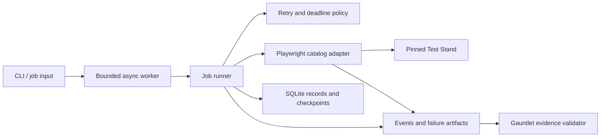

# Resilient Browser Automation — Python

**Browser automation designed around correct data, bounded recovery, and reproducible evidence.**

A Python and Playwright browser worker being built to handle interrupted jobs,
transient failures, expired sessions, changing selectors, and duplicate records.
The project combines a working implementation with practical walkthroughs of
the decisions behind reliable web data extraction.

[Roadmap](#roadmap) · [Engineering walkthroughs](#engineering-walkthroughs) ·
[Issues](https://github.com/bockuden/resilient-browser-automation-python/issues) ·
[Test Stand](https://github.com/bockuden/resilient-automation-test-stand) ·
[C# companion](https://github.com/bockuden/resilient-browser-automation)

## Project status

**Planning — implementation has not started.** This repository currently contains
the project roadmap, MIT license, and 36 published implementation issues across
six milestones. The capabilities and architecture below are planned.

There is no runnable worker, published Python package, or passing CI claim yet.
Installation and demo commands will be added when the first working slice is
available. Start with
[issue #1: package and development toolchain](https://github.com/bockuden/resilient-browser-automation-python/issues/1)
or browse the
[milestones](https://github.com/bockuden/resilient-browser-automation-python/milestones).

## The problem

A browser script can work once and still fail as a data collection system.
Pages load late, sessions expire halfway through a job, targets return rate
limits, and processes stop after some results have already been saved.

This project focuses on what happens at those boundaries: which operations may
be retried, what state must survive a restart, how to recognize invalid data,
and what evidence explains a failure afterward.

The goal is a compact, inspectable Python implementation with explicit
guarantees, validated against a deterministic target and explained through
runnable examples.

## Planned capabilities

| Area | Intended behavior |
| --- | --- |
| Browser extraction | Asynchronous Playwright, observable readiness, validated records, and natural pagination end. |
| Retry policy | Classified transient failures, bounded backoff, `Retry-After`, and a total job deadline. |
| Authentication | Isolated job contexts, browser login, and bounded recovery after session expiry. |
| Selector changes | Explicit semantic fallbacks; ambiguous controls fail visibly. |
| Durable state | SQLite transactions that commit page records and their checkpoint together. |
| Idempotency | Stable job/item identities and duplicate delivery without duplicate persisted results. |
| Restart recovery | Continuation from durable progress, tested after forced process termination. |
| Controlled execution | Bounded intake, concurrency, per-target pacing, and graceful cancellation. |
| Diagnostics | Structured events, execution summaries, and bounded screenshot, HTML, and trace capture. |
| Verification | Real-browser E2E, independent database checks, and evidence generated from actual runs. |

## Planned architecture

The runner will own execution rules. The browser adapter will own target
interaction. Storage will own durable state and transaction boundaries.
Target-specific selectors and stand configuration will stay outside the
general execution logic.

The Python design will share useful behavioral guarantees with the C# companion
while using Python's own async resource management, cancellation, typing, and
testing conventions.

## How correctness will be demonstrated

The worker will run against the independently released
[Resilient Automation Test Stand](https://github.com/bockuden/resilient-automation-test-stand).
Its
[Automation Gauntlet](https://github.com/bockuden/resilient-automation-test-stand/blob/main/CHALLENGE.md)
defines ten levels covering pagination, retries, authentication, selector
changes, deduplication, checkpoint recovery, session expiry, rate limiting,
and combined failures.

The planned acceptance path is:

1. Run a real browser against a pinned stand release with an isolated run ID.
2. Record observed statuses, retry waits, raw item IDs, and recovery events.
3. Validate the generated evidence with the stand's published validator.
4. Independently inspect committed records and checkpoints in SQLite.
5. Retain the consumer revision, environment details, and diagnostic artifacts.

Worker-level tests will also cover forced process termination, transaction
failure windows, browser loss, and cancellation. These checks complement the
target-server scenarios.

**All ten Gauntlet levels are planned; no level is currently claimed as passed
by this Python implementation.** Track the work in
[M4 — Reproducible evidence](https://github.com/bockuden/resilient-browser-automation-python/milestone/4).

## Engineering walkthroughs

Six short walkthroughs will connect the implementation to practical automation
problems:

| Walkthrough | Question it answers |
| --- | --- |
| Readiness and extraction | How do we distinguish a ready page, a valid empty result, and a loading failure? |
| Retries and rate limits | What can we repeat safely, and when must we stop waiting? |
| Authentication and sessions | How do we restore a session and continue the intended work? |
| Transactions and recovery | What survives if the process stops while saving a page? |
| Concurrency and cancellation | How do we bound resource use and stop cleanly? |
| Diagnosis and artifacts | How do we explain a failed run without reproducing it first? |

Each chapter will include a reproducible failure, the implemented remedy, a
verification command, and its limitations. Examples will use the tested worker
modules rather than a separate tutorial implementation.

## Planned stack

- **Python / asyncio** — orchestration, bounded work, and cancellation.
- **Playwright / Chromium** — real browser interaction and diagnostic capture.
- **SQLite** — local job state, deduplication, and transactional checkpoints.
- **pytest** — unit, integration, subprocess, and browser acceptance tests.
- **Ruff and a static type checker** — code quality and explicit interfaces.
- **Docker and GitHub Actions** — reproducible targets and automated validation.

Supported Python versions, dependency pins, and the type checker will be chosen
in [B01 / issue #1](https://github.com/bockuden/resilient-browser-automation-python/issues/1).

## Roadmap

| Milestone | Issues | Completion goal |
| --- | --- | --- |
| [M1 — Runnable browser-to-database flow](https://github.com/bockuden/resilient-browser-automation-python/milestone/1) | #1–#8 | A real browser job with verified persisted output. |
| [M2 — Recovery and correctness](https://github.com/bockuden/resilient-browser-automation-python/milestone/2) | #9–#15 | Retries, validation, checkpoint resume, and forced-process recovery. |
| [M3 — Controlled execution and diagnostics](https://github.com/bockuden/resilient-browser-automation-python/milestone/3) | #16–#21 | Bounded concurrency, target pacing, cancellation, and artifacts. |
| [M4 — Reproducible evidence](https://github.com/bockuden/resilient-browser-automation-python/milestone/4) | #22–#27 | Live evidence, ten Gauntlet levels, and CI verification. |
| [M5 — Portfolio release](https://github.com/bockuden/resilient-browser-automation-python/milestone/5) | #28–#33 | Compatibility matrix, walkthroughs, demo, and release artifacts. |
| [M6 — Optional extensions](https://github.com/bockuden/resilient-browser-automation-python/milestone/6) | #34–#36 | Measurements, a second target, and HTTP/browser tradeoffs. |

M6 is optional and does not block the initial release. Every issue has scope,
acceptance criteria, priority, and dependency links. See the
[detailed backlog](GITHUB_BACKLOG.md) for the original plan; GitHub issues track
ongoing progress.

## Scope and guarantee boundaries

The initial deployment will support one worker process per local state database.
Distributed execution and production-scale crawling are outside the initial
scope.

Idempotent persisted results do not imply exactly-once network requests or
exactly-once external side effects. Resume behavior also depends on the target's
pagination and dataset stability; those assumptions will be documented per
adapter.

Screenshots, HTML, and traces may contain target data. Artifact capture will
have explicit controls and documented privacy limits. Deterministic test-stand
success establishes behavior for the tested contract, not universal website
compatibility.

## Related projects

| Project | Role |
| --- | --- |
| [Resilient Automation Test Stand](https://github.com/bockuden/resilient-automation-test-stand) | Independently versioned deterministic failure scenarios and the Gauntlet validator. |
| [Resilient Browser Automation — C#](https://github.com/bockuden/resilient-browser-automation) | Companion implementation for comparing tested behavioral guarantees across languages. |

## Author and license

Created by [Yehor Maksimov](https://github.com/bockuden).

[MIT License](LICENSE) — Copyright (c) 2026 Yehor Maksimov.
